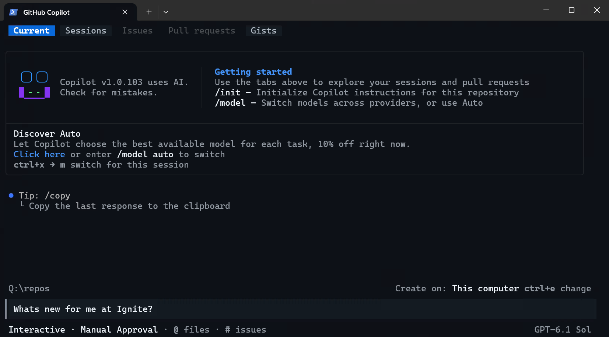

# Microsoft Events CLI

A [GitHub Copilot CLI](https://github.com/features/copilot/cli/) skill that connects your local project to Microsoft event session catalogs. It reads your dependencies, finds relevant sessions, and helps you act on what you learn — all from your terminal.



## Quick Start

1. Open **GitHub Copilot CLI** in any project and run:
   ```
   /plugin install microsoft/Build-CLI
   ```
2. Restart your Copilot CLI session:
   ```
   /restart
   ```
3. Try:
   ```
   What Ignite 2026 sessions are relevant to my project?
   ```

The skill reads `package.json`, `requirements.txt`, `.csproj`, `go.mod`, and other dependency files, maps them to Microsoft products, and searches live event catalogs (default: Ignite 2026).

## Requirements

- [GitHub Copilot CLI](https://github.com/features/copilot/cli/) installed and authenticated
- **Node.js 22+** (recommended) — enables the `@microsoft/events-cli` for faster local search and caching. Without Node.js, the skill falls back to direct HTTP and everything still works.

## What You Can Do

📺 **[Watch the overview video](https://www.youtube.com/watch?v=gm8gKtrd3po)** to see it in action.

### Before an event — plan your schedule

| Ask the skill to…                        | Example                                               |
|------------------------------------------|-------------------------------------------------------|
| Build a personalized session path        | *"Find sessions for me for an IT admin focused on Entra, Intune, and Defender."* |
| See what's new for your stack            | *"What's new for me at Ignite with Node.js, TypeScript, Functions, and Cosmos DB?"* |
| Look up a specific session               | *"Tell me about session BRK155."*                     |

### During an event — capture what matters

| Ask the skill to…                        | Example                                               |
|------------------------------------------|-------------------------------------------------------|
| Log notes tied to a session              | *"Log a note from session BRK155: key governance steps and rollout risks."* |
| Get immediate follow-up actions          | *"What should I do after session BRK155?"*            |
| Build a supplemental learning path       | *"Build a supplemental learning path for BRK155 and BRK223."* |

### After an event — ship what you learned

| Ask the skill to…                        | Example                                               |
|------------------------------------------|-------------------------------------------------------|
| Create an operational checklist          | *"Create an operational learning checklist from BRK155 for our IT admin team."* |
| Scaffold from a technical session        | *"Scaffold a project from session BRK155."*           |
| Ground recommendations in your context   | *"Ground recommendations in my authorized context and show traceability."* |

## How It Works

The skill is a thin layer over **live Microsoft event session catalogs** — no stale data, no manual updates. For SDK docs and code samples, it falls back to the [Microsoft Learn MCP Server](https://learn.microsoft.com/training/support/mcp).

Session results are a starting point. For broad topics, ask the agent to refine (*"show me more Foundry sessions about observability"*) or browse full catalogs at [ignite.microsoft.com/sessions](https://ignite.microsoft.com/sessions) and [build.microsoft.com/sessions](https://build.microsoft.com/sessions).

> [!NOTE]
> This skill defaults to **Ignite 2026** and also supports Build 2026. It is not a replacement for the event app or session browser — it's a developer and IT-pro complement to them.

## Supported Clients

| Client | Configuration |
|--------|---------------|
| GitHub Copilot CLI | `/plugin install microsoft/Build-CLI` then `/restart` |
| VS Code | Open Extensions (Ctrl+Shift+X), search `@agentPlugins microsoft-events`, and install |
| Visual Studio 2026 | Copy `skills/microsoft-events/` to a [supported skill location](https://learn.microsoft.com/visualstudio/ide/copilot-agent-skills) |
| Claude Code | `/plugin marketplace add microsoft/Build-CLI` then `/plugin install microsoft-events@microsoft-events-marketplace` |

## Scope and Limitations

- **Event-scoped:** Defaults to Ignite 2026, with Build 2026 also available. The architecture supports any event that uses the same catalog endpoints.
- **Dependency-driven:** Recommendations are only as good as the dependency files in your project root. If your project doesn't have a manifest file, tell the skill your stack directly.
- **Not offline:** Requires network access to query the catalog and Learn MCP server.

## Contributing

See [CONTRIBUTING.md](CONTRIBUTING.md) for details on how to contribute to this project.

## Trademarks

This project may contain trademarks or logos for projects, products, or services. Authorized use of Microsoft
trademarks or logos is subject to and must follow
[Microsoft's Trademark & Brand Guidelines](https://www.microsoft.com/legal/intellectualproperty/trademarks/usage/general).
Use of Microsoft trademarks or logos in modified versions of this project must not cause confusion or imply Microsoft sponsorship.
Any use of third-party trademarks or logos are subject to those third-party's policies.
